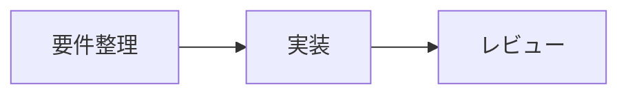

# プロジェクト週次レポート

Happy Markdownの表示確認用ドキュメントです。登場するプロジェクト・担当者・数値はすべてサンプルです。

| レポート情報   | 内容                     |
| :------------- | :----------------------- |
| 対象期間       | 2026年11月9日〜11月13日  |
| プロジェクト   | 社内ナレッジポータル刷新 |
| 作成者         | 開発チーム               |
| 全体ステータス | 🟡 一部に確認待ちあり    |

## 目次

- [今週の進捗](#今週の進捗)
- [引用・注意事項](#引用注意事項)
- [コード](#コード)
- [折りたたみ](#折りたたみ)
- [スケジュールと課題](#スケジュールと課題)
- [文字とレイアウトの確認](#文字とレイアウトの確認)
- [将来の拡張候補](#将来の拡張候補)

## 今週の進捗

本文の **強調**、_斜体_、~~取り消し線~~、`インラインコード` と [VS Codeの公式ドキュメント](https://code.visualstudio.com/docs) を確認できます。

### タスク一覧

- [x] リポジトリ作成
- [x] プレビュースタイルのひな型作成
- [ ] チーム内でデザインを確認
  - 見出しの階層と余白
  - 表とコードの視認性

| 項目     | 担当   | 状態   |
| :------- | :----- | :----- |
| 要件整理 | PM     | 完了   |
| 実装     | 開発   | 作業中 |
| レビュー | チーム | 未着手 |

## 引用・注意事項

> NOTE: リリース前にレビューを実施します。
>
> 引用内の複数段落も確認できます。

> WARNING: スケジュール変更の可能性があります。

引用は共通のカード風デザインです。種類ごとの解析・色分けは未実装です。

## コード

### TypeScript

```typescript
interface Project {
  name: string;
  status: "planned" | "active" | "done";
}

const project: Project = {
  name: "Happy Markdown",
  status: "active",
};
```

### JSON設定

```json
{
  "project": "knowledge-portal",
  "preview": {
    "theme": "workspace",
    "showTableOfContents": true
  },
  "reviewers": ["佐藤", "鈴木"]
}
```

このJSONは表示確認用の架空の設定です。本拡張の設定項目ではありません。

### コマンド

```sh
# 拡張機能の配布パッケージを作成
npm run package

# ローカルのVS Codeへインストール
code --install-extension happy-markdown-0.3.0.vsix
```

### 長い行・プレーンテキスト

```text
2026-11-12 09:30:00 INFO project=knowledge-portal task=preview-design-review status=in-progress reviewer=development-team message="Check headings, tables, blockquotes, code blocks, and details in a narrow preview panel."
```

## 折りたたみ

<details>
<summary>レビュー時の確認事項</summary>

- 長い本文でも読みやすいこと
- 表の列が区別できること
- キーボードで折りたたみを操作できること

</details>

<details open>
<summary>最初から開いている補足情報</summary>

プレビューの幅を狭くした状態でも、表・リスト・本文の余白を確認します。

| 確認対象 | 期待する表示                         |
| :------- | :----------------------------------- |
| 本文     | ペインの幅に合わせて折り返す         |
| コード   | インデントを保ち、長い行を確認できる |

</details>

## スケジュールと課題

### マイルストーン

| マイルストーン | 予定日 | 進捗率 | 判定   |
| :------------- | :----: | -----: | :----- |
| 要件整理       | 11/09  |   100% | 完了   |
| プレビュー実装 | 11/12  |    75% | 作業中 |
| チームレビュー | 11/16  |     0% | 予定   |
| 社内配布       | 11/20  |     0% | 予定   |

### 課題管理

| ID        | 課題                               | 優先度 | 対応方針                                     |
| :-------- | :--------------------------------- | :----: | :------------------------------------------- |
| ISSUE-001 | ダークテーマで表の境界が読みづらい |   高   | テーマを切り替えて罫線の色を確認する         |
| ISSUE-002 | 長いコード行がプレビュー幅を超える |   中   | 狭いペインで横スクロールできることを確認する |
| ISSUE-003 | 独自の決定事項カードを表示したい   |   低   | Markdown-itによる拡張を次の段階で検討する    |

### レビューの進め方

1. `F5` でExtension Development Hostを起動する。
2. このファイルのMarkdownプレビューを開く。
3. テーマを切り替えて確認する。
   - ライトテーマ
   - ダークテーマ
   - ハイコントラストテーマ
4. 気になる箇所を課題として記録する。

> レビュー担当者からのコメント
>
> 見出しと表の読みやすさを優先してください。
>
> > 補足：引用が入れ子になったときの余白も確認します。

## 文字とレイアウトの確認

### 見出しレベル3

本文と見出しの間隔を確認するための段落です。

#### 見出しレベル4

小さな節のタイトルです。

##### 見出しレベル5

詳細な補足のタイトルです。

###### 見出しレベル6

最も深い見出しです。

### インライン表現

- **太字**：重要な結論や期限
- _斜体_：補足や用語
- ~~取り消し線~~：変更前の情報
- **太字の中に `inline code`**：設定名の強調
- 特殊文字：`<section>`、`A & B`、`a_b_c`、`C:\\projects\\docs`
- エスケープ：\*強調しないアスタリスク\*、\[通常の角括弧\]
- 日本語とEnglish、数字12345、記号 → ✓ ⚠ の混在

### 長い文章

この段落は折り返しと行間の確認用です。プロジェクトの状況を共有する文書では、背景、現在の課題、対応方針、担当者への依頼などを続けて記載することがあります。プレビューの幅を狭めたときにも文字が読みやすく、段落の境界が分かり、見出しや表との間に適切な余白があることを確認してください。日本語とEnglish wordsが混在したときの表示も合わせて確認します。

長い識別子：project_knowledge_portal_markdown_preview_design_review_abcdefghijklmnopqrstuvwxyz_0123456789_abcdefghijklmnopqrstuvwxyz_0123456789

### 区切り線

ここまでが今回の確認対象です。

---

ここからは今後の拡張を検討するための記法サンプルです。

## 将来の拡張候補

以下は独自カード化の検討用です。このひな型では通常の引用として表示します。

> [!NOTE]
> 次回のレビュー資料は前日までに共有してください。

> [!WARNING]
> 顧客確認の結果によってリリース日を変更する可能性があります。

> [!DECISION]
> 次回の定例会でデザインを確定する。

> [!TODO]
> 顧客へ確認する。

Mermaidの描画機能はこの拡張には含まれていません。対応するVS Code環境・別拡張がある場合に表示を確認してください。



## チェック操作の確認

専用プレビューでチェックを操作し、元のMarkdownへの反映とUndo / Redoを確認してください。

- [ ] チームにレビューを依頼
  - [ ] ライトテーマを確認
  - [x] ダークテーマを確認
- [x] 大文字のチェック済み記法

> - [ ] 引用内のタスク

1. [ ] 番号付きタスク
2. [x] 完了した番号付きタスク

```markdown
- [ ] このコード例は操作対象になりません
```
