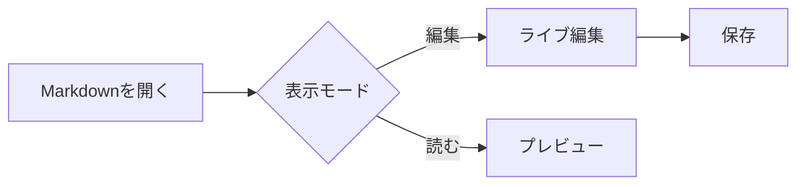
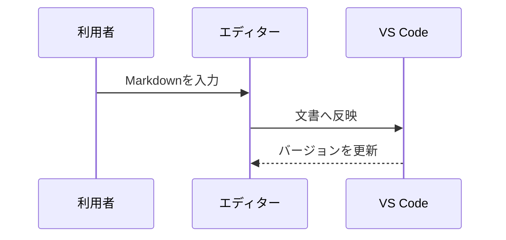

# Mermaidの表示確認

専用画面のライブ編集・プレビューで使う確認用文書です。ライブ編集では図の外へカーソルを移すと図を表示し、「記法を編集」でコードへ戻れます。

## フローチャート



## シーケンス図



## エラー時の保持

次の図は意図的に構文を壊しています。エラー表示後も記法を修正でき、前後の文章が残ることを確認します。

```mermaid
flowchart LR
    A[閉じていない
```

この文章は図の描画結果にかかわらず保持します。

[プレビュー仕様](preview.md) / [Wikiホーム](../../README.md)
